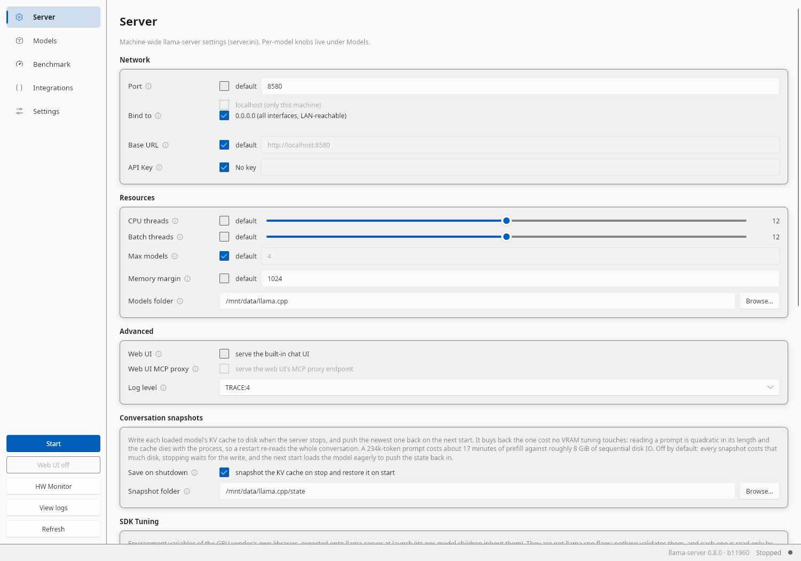
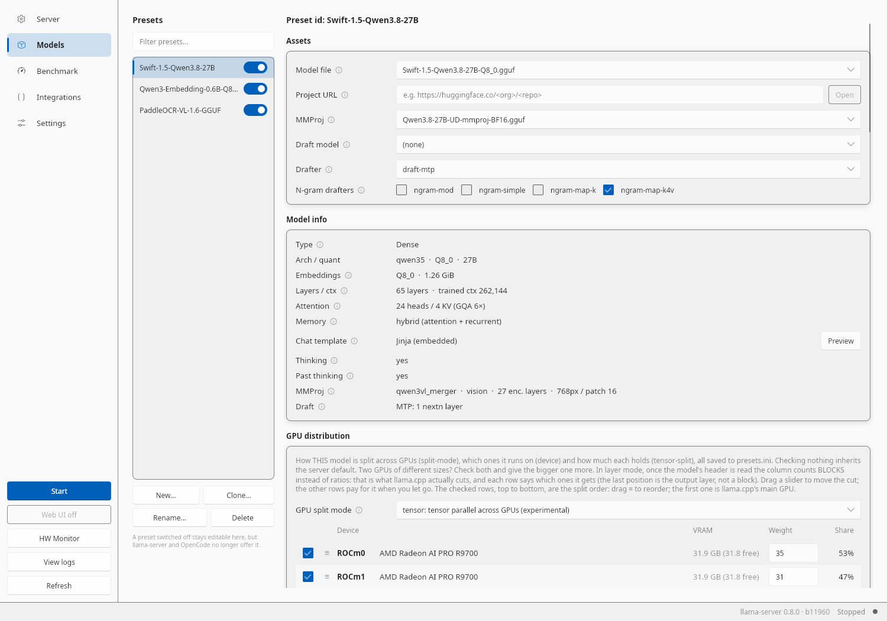
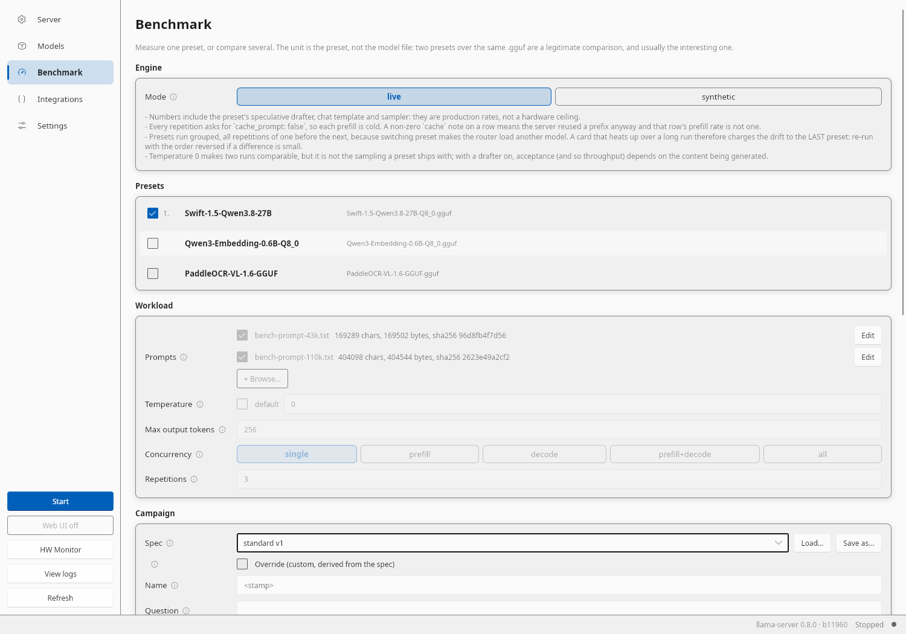
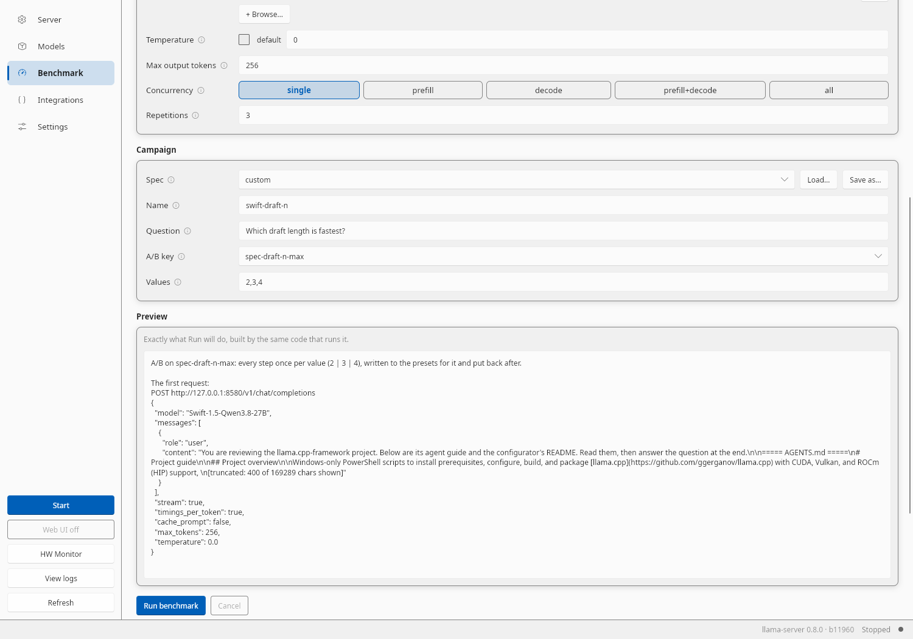
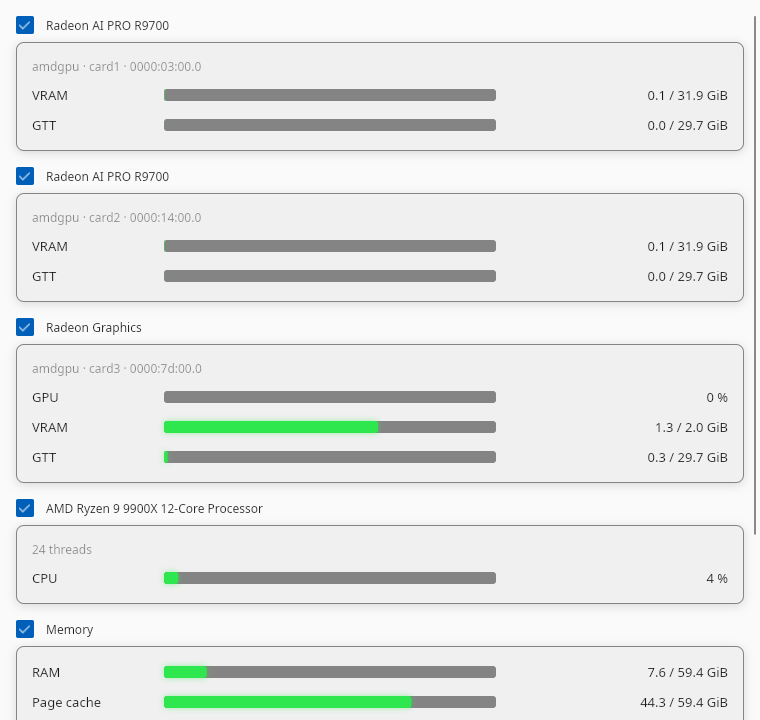

# llama.cpp-framework

> **Windows first**: the full pipeline (build, installer) targets Windows 10/11 and ends in an MSI. Linux ends in a `.deb` and an `.rpm` (see [Linux](#linux)), macOS on Apple Silicon in a `.pkg` (see [macOS](#macos), untested).

A build orchestrator, run with cargo (`cargo run -p xtask -- <phase>`, the crate in `xtask/`), that builds and packages [llama.cpp](https://github.com/ggerganov/llama.cpp) with multi-GPU backend support (CUDA, Vulkan, ROCm/HIP on Windows and Linux; Metal and Vulkan on macOS) and MSI packaging (WiX Toolset) on Windows. The chat UI built into `llama-server` is used as the frontend; no separate web UI is bundled.

Beside llama.cpp it ships **`llama-cpp-config`**, a GUI + CLI configurator (Rust, [Slint](https://slint.dev)) that writes `llama-server`'s `server.ini` and per-model `presets.ini`, starts and stops the server, and benchmarks presets into a public SQLite database (`benchmarks/bench.db`) with a versioned method, so numbers from two machines compare like with like.

## Screenshots

| | |
|---|---|
|  |  |
| **Server**: machine-wide `server.ini` (network, threads, models folder, conversation snapshots, GPU SDK tuning). | **Models**: one preset per model, with the GGUF header read in place (layers, attention, MTP head, vision encoder) and the GPU distribution as a table of detected devices. |
|  |  |
| **Benchmark** with the `standard v1` spec chosen: the spec ticks its two pinned prompts and fixes the workload fields. | **Benchmark** A/B: one preset key (`spec-draft-n-max`) at three values, each one written to the preset with a restart, put back afterwards. |

<p align="center"><br><b>HW Monitor</b>: VRAM, GTT spill, GPU, CPU and memory per device, once a second.</p>

## Features

**Build and packaging** ([docs/build-pipeline.md](docs/build-pipeline.md))

- One cargo orchestrator for every OS: `cargo run -p xtask -- prereq | configure | build | package | install`; the only non-cargo step is the bootstrap that installs Rust and the system packages.
- Always the newest llama.cpp **release** tag (`vX.Y.Z`, never a `bNNNN` nightly), CMake + Ninja, sccache, the machine-independent CMake options in `xtask/cmake/*.toml` with a reason for each.
- Backends: CUDA, Vulkan and ROCm/HIP on Windows and Linux (RCCL/NCCL for `--split-mode tensor` on Linux); Metal and Vulkan through MoltenVK on Apple Silicon.
- GPU SDKs (ROCm TheRock, CUDA, Vulkan SDK) installed side by side as `<root>/<Name>/<Version>/<os>`, newest stable, found there and nowhere else; no machine-wide SDK variables.
- Self-contained packages: an MSI (WiX, upgrades, downgrade refused, ICE-validated), a `.deb` and an `.rpm` under `/opt/llama.cpp`, a `.pkg` on macOS; the ROCm, CUDA and Vulkan runtimes the backends load are bundled, so a target machine needs only the GPU driver.
- Out-of-tree llama.cpp patches in `patches/llama.cpp/`, applied on every build and reverted before the next checkout, each with its source, digest and the condition to drop it: a trimmed MTP draft vocabulary for Qwen3.5/3.8, an RDNA4 WMMA FlashAttention kernel for small query batches, pinned host buffers on every runtime, and an upstream MTP fix.

**Configurator** ([llama-cpp-config/README.md](llama-cpp-config/README.md))

- Five tabs (Server, Models, Benchmark, Integrations, Settings), a tray icon, a live log viewer, and the HW Monitor window (GPU, VRAM and its spill into system memory, PCIe traffic on NVIDIA, CPU, memory, disk).
- Presets edited as forms with every llama-server knob explained in place; GPU distribution (`device`, `split-mode`, `tensor-split`) as a table of detected GPUs, tensor placement (`override-tensor`) as ordered rules, the vision encoder's GPU on its own.
- Hugging Face search and download that creates the preset and recommends a quantization that fits this machine's GPUs.
- Conversation snapshots: each model's KV cache saved on stop and restored on the next start, so a restart does not re-read a long conversation.
- Integrations: the OpenCode provider (one model per enabled preset) and a Claude Code environment snippet; log rotation; start at login.
- The same operations headless: `llama-cpp-config server|preset|control|bench ...`.

**Benchmarks** ([benchmarks/README.md](benchmarks/README.md))

- Two engines: **live** (real `llama-server` requests, cold prefill every repetition, the preset's drafter and sampler included) and **synthetic** (`llama-bench`, raw prefill and decode).
- Concurrency scenarios at the preset's `parallel`: single, N prefills at once, N decodes at once, prefill and decode mixed.
- **Versioned specs** (`benchmarks/specs/standard.ini`, compiled into the binary): prompts pinned by sha256, temperature, repetitions, concurrency and per-pass overrides; every run records the spec, its version and digest, and anything changed from it is recorded as a derivation, never as the spec.
- A/B of one preset key (`bench sweep --key ... --values ...`, or the tab's A/B field) with the key put back afterwards; an interrupted run leaves a marker with the value to restore.
- Every finished run in SQLite with the machine, the software stack (llama.cpp, ROCm, CUDA, Vulkan SDK), the model and every parameter; `bench query` to read it; absolute paths and secrets dropped on the way in, so the database can be public.
- A GPU lock every benchmark holds, plus a check that no other process has the GPUs open.

**Measured guides** ([docs/](docs/AGENTS.md)): the per-card settings for the Radeon AI PRO R9700 and the RTX 4070 SUPER, and per-model guides for Qwen3.8-Flash-Next and Qwen3.8-27B, each value citing the bench.db campaign it comes from.

## Prerequisites

- Windows 10/11
- [Visual Studio](https://visualstudio.microsoft.com/) with C++ workload
- [Git](https://git-scm.com/)

Installed/updated via winget by `scripts\00-install-prerequisites.ps1`:
- [PowerShell 7+](https://github.com/PowerShell/PowerShell)
- [OpenSSL](https://slproweb.com/products/Win32OpenSSL.html)
- [.NET SDK 10](https://dotnet.microsoft.com/) (hosts the WiX Toolset)

Installed/updated from its GitHub release (winget lags upstream by days) into `%LOCALAPPDATA%\Programs\sccache`, also by `scripts\00-install-prerequisites.ps1`:
- [sccache](https://github.com/mozilla/sccache) (compiler cache for the C/C++ and HIP compiles)

Installed as a .NET global tool at the version pinned in `installer\wix-toolset.psd1`, with its UI and Util extensions, also by `scripts\00-install-prerequisites.ps1`:
- [WiX Toolset](https://wixtoolset.org/) 7 (builds the MSI). WiX 7 asks each user to accept its EULA once before it builds anything (Open Source Maintenance Fee: organizations above USD 10,000 yearly revenue owe the fee); the scripts never accept it for you: read it, then run `wix eula accept wix7`.

GPU SDKs, installed/updated to their newest stable release by `scripts\00-install-prerequisites.ps1`, side by side as `<DistRoot>\<Name>\<Version>\windows` (e.g. `E:\TheRock\10.1.0\windows`):
- [AMD ROCm (TheRock dist)](https://rocm.docs.amd.com/) in `TheRock`
- [CUDA Toolkit](https://developer.nvidia.com/cuda-toolkit) in `CUDA` (assembled from NVIDIA's redist archives; no driver touched)
- [Vulkan SDK](https://vulkan.lunarg.com/) in `VulkanSDK`

`DistRoot` defaults to `E:\` (`installer\dist-sources.psd1`). Pass `-DistRoot <path>` to `scripts\00-install-prerequisites.ps1` and `--dist-root <path>` to `xtask configure`, or set `LLAMA_FW_DIST_ROOT`, to keep them elsewhere; `xtask configure` records the root, so the later steps need nothing. The build takes its GPU SDKs from this layout only.

## Quick start

Every step is a cargo command from the repo root, except the first: the toolchain, Rust included, has to exist before cargo does.

```powershell
# 1. Install / update the toolchain (elevates via UAC as needed): winget packages,
#    Rust, sccache, WiX, the GPU SDKs. Re-run any time to upgrade them and check
#    llama.cpp for a newer release tag.
.\scripts\00-install-prerequisites.ps1

# 2. Auto-detect paths and generate config-build.psd1
cargo run -p xtask -- configure

# Or override the llama.cpp source clone location:
cargo run -p xtask -- configure --llama-cpp-dir "C:\path\to\my\llama.cpp"

# Or keep the SDKs on another drive (give the prerequisites script the same root as -DistRoot):
cargo run -p xtask -- configure --dist-root "D:\sdk"

# 3. Build llama.cpp
cargo run -p xtask -- build

# 4. Produce the Windows installer (.msi) in dist\
cargo run -p xtask -- package

# 5. Install it on this machine (UAC prompt; upgrade, repackage or downgrade alike)
cargo run -p xtask -- install
```

## Linux

Debian/Ubuntu: the same cargo phases end at a working `llama-server` with the CUDA, Vulkan and HIP backends and `llama-cpp-config` beside it, packaged as a `.deb` and an `.rpm`.

```bash
# 1. First time only (no Rust yet): apt packages (sudo), Rust (rustup), then the dists.
scripts/00-install-prerequisites.sh

#    Afterwards, to update sccache and the newest stable ROCm/TheRock dist,
#    CUDA Toolkit, NCCL and Vulkan SDK:
cargo run -p xtask -- prereq

# 2. Auto-detect paths and generate build/linux/config-build.toml
cargo run -p xtask -- configure

# 3. Build llama.cpp and llama-cpp-config into build/linux/llama.cpp-cmake/bin/
cargo run -p xtask -- build

# 4. Package: dist/llama-cpp-framework-v<version>-<llamaRelease>-amd64.deb and -x86_64.rpm
cargo run -p xtask -- package

# 5. Install (or upgrade, or reinstall) the newest package in dist/: the .deb or the .rpm,
#    as the distribution takes (sudo)
cargo run -p xtask -- install
```

The packages (about 1.2 GB each, 3.3 GB installed) are self-contained under `/opt/llama.cpp/`: the binaries in `bin/` and, in `lib/`, the ROCm, CUDA and Vulkan runtime libraries the backends need, so the target machine needs the GPU drivers and nothing else. They also install a symlink per executable in `/usr/bin/` (`llama-server`, `llama-cpp-config`, the other llama.cpp tools), a desktop entry that puts the configurator ("llama.cpp Config") in the applications menu, and nothing else: `llama-cpp-config` keeps `server.ini`, `presets.ini`, `presets.ini.disabled` and `settings.ini` per user in `~/.config/llama.cpp/` (logs, benchmark runs and saved states in `~/.local/share/llama.cpp/`). A backend whose GPU or driver is missing is skipped at start.

The dists install side by side as `<root>/<version>/linux` under `/mnt/data` (`TheRock`, `CUDA`, `VulkanSDK`; for another mountpoint pass `--dist-root <path>` to `scripts/00-install-prerequisites.sh` and `xtask configure`, which records it, or set `LLAMA_FW_DIST_ROOT`), about 27 GB in all, and nothing is added to the environment: the scripts find the newest of each on every run. Everything generated lives under `build/linux/`, apart from the Windows artifacts under `build/windows/`. Details: [docs/build-pipeline.md](docs/build-pipeline.md#linux).

## macOS

Apple Silicon only, Metal and Vulkan (through MoltenVK). **Untested**: written and compile-checked on Linux, not yet run on a Mac.

```bash
# 1. First time only: checks the Xcode Command Line Tools, installs cmake, ninja and
#    node with Homebrew, Rust (rustup), then the Vulkan SDK (into ~/dists, no sudo).
scripts/00-install-prerequisites.sh
#    Afterwards: cargo run -p xtask -- prereq

# 2. to 5., as on Linux:
cargo run -p xtask -- configure
cargo run -p xtask -- build
cargo run -p xtask -- package    # dist/llama-cpp-framework-v<version>-<llamaRelease>-arm64.pkg
cargo run -p xtask -- install    # sudo installer -pkg ... -target /
```

The package installs into `/opt/llama.cpp/` with a symlink per executable in `/usr/local/bin/`; it is unsigned and not notarized. Details: [docs/build-pipeline.md](docs/build-pipeline.md#macos).

## Layout

All build artifacts live under `build\`, in a per-OS directory (`build\windows\`, `build/linux/`, `build/macos/`), so a single `rm -rf build\` returns the repo to a clean state.

```
<repo>/
├── build/
│   └── windows/
│       ├── .sccache/           ← sccache compile cache
│       ├── cargo-target/       ← cargo target dir of llama-cpp-config
│       ├── config-build.psd1   ← build-time config (generated by xtask configure)
│       ├── llama.cpp/          ← llama.cpp source clone (LlamaCppDir)
│       ├── llama.cpp-cmake/    ← cmake binary dir (out-of-source build)
│       ├── staging/            ← the tree the MSI installs (xtask package, removed unless --keep-staging)
│       └── wix-obj/            ← WiX intermediates (xtask package, transient)
├── dist/                    ← final installer .msi
├── installer/               ← the MSI source (.wxs + custom-action script), the WiX pin, dist-sources.psd1 (where external dists come from)
├── llama-cpp-config/        ← Rust GUI + CLI configurator (source)
├── patches/                 ← checked-in build workarounds (HIP clang runtime wrapper, per clang major)
├── resources/               ← icon generator (llama.ico is built on demand, gitignored)
├── scripts/                 ← helpers: 00-install-prerequisites (.ps1/.sh) and thin wrappers over the cargo phases
└── xtask/                   ← the build orchestrator (cargo run -p xtask -- <phase>): src/{common,linux,windows,macos}/, cmake/ (the llama.cpp CMake options: common.toml, <os>.toml)
```

## Configuration

Settings are split between build-time and runtime so the same scripts work both in-tree and from a system install.

| File | Where | Purpose |
|------|-------|---------|
| `config-build.psd1` | `build\windows\` (gitignored) | Build-time paths and flags. Generated by `xtask configure`. |
| `server.ini` | `%LOCALAPPDATA%\llama.cpp\config\` | Machine-wide llama-server runtime (port, host, threads, threads-batch, models dir, max simultaneous models). Single `[Server]` section. Written by `llama-cpp-config`. |
| `presets.ini` | `%LOCALAPPDATA%\llama.cpp\config\` | Per-model presets: one `[<model-id>]` section each with model path, ctx size, GPU layers, GPU distribution (device / split-mode / tensor-split), load mode, the image encoder's device, batch sizes, cache types, flash-attn, sampling, MoE expert offload, chat-template kwargs, speculative decoding (draft model / spec-type / draft device+layers). Consumed directly by `llama-server --models-preset`. Written by `llama-cpp-config`. |

> **GPU distribution** is edited as a table, not as free text: `--tensor-split` is a positional vector over the devices named by `--device`, so the configurator lists the detected GPUs with a checkbox and a weight each and derives both settings from that. The [configurator README](llama-cpp-config/README.md#gpu-distribution-table) has the details, including the two footguns it exists to make visible: a blank tensor-split over 2+ GPUs means *split by free VRAM*, not evenly; and the **image encoder (mmproj/CLIP) is placed on its own**: it follows the first `--device` entry, and with no device pinned llama.cpp puts it on the first GPU backend it finds, where it holds VRAM but only works on image requests; the preset's Vision GPU dropdown overrides both.

`config-build.psd1` keys:

| Section | Keys |
|---------|------|
| Paths | `DistRoot`, `LlamaCppDir`, `OpenSSLDir`, `HipPath`, `VsDevShell`, `WixExe` |
| Build | `GpuTargets`, `BuildType`, `CCompiler`, `CxxCompiler`, `Linker`, `BuildJobs` |

Runtime configs are created and edited with `llama-cpp-config` (GUI when launched with no arguments, headless CLI via `server` / `preset` subcommands). The installer ships it in `bin\` next to `llama-server.exe`, with an optional Start Menu shortcut ("llama.cpp Config"). See [llama-cpp-config\README.md](llama-cpp-config/README.md).

## Phases

`xtask <phase>` below is short for `cargo run -p xtask -- <phase>`, run from the repo root; `cargo run -p xtask -- <phase> --help` lists each phase's options. `scripts\` holds only helpers: the prerequisites bootstrap and wrappers that run the same cargo commands.

| Command | Description |
|---------|-------------|
| `scripts\00-install-prerequisites.ps1` | Windows: idempotent toolchain bootstrapper, the one step that is not cargo (it installs what cargo needs). Installs missing winget packages (PowerShell 7+, OpenSSL, the .NET SDK) and upgrades present ones in a single UAC-elevated session, which also installs the newest stable ROCm/TheRock dist, CUDA Toolkit and Vulkan SDK into `<DistRoot>\<Name>\<Version>\windows`; installs or updates sccache from its latest GitHub release (sha256-verified, user scope); installs the WiX Toolset at its pinned version with its extensions (and reports a WiX EULA still to accept); fetches the llama.cpp clone and flags a rebuild when a newer release tag is available. Accepts `-DistRoot`. |
| `scripts/00-install-prerequisites.sh` | Linux and macOS: the system packages (apt, or Homebrew) and Rust, then `xtask prereq`. |
| `xtask prereq` | Linux and macOS: sccache and the newest stable GPU SDK dists, the llama.cpp release check. Accepts `--dist-root`, `--skip`. |
| `xtask configure` | Detects environment, verifies tools, writes the build config (`config-build.psd1` on Windows, `config-build.toml` elsewhere). Accepts `--llama-cpp-dir` and `--dist-root`. |
| `xtask build` | Builds **both** llama.cpp (CMake configure out-of-source into `build\<os>\llama.cpp-cmake\` + Ninja, checked out at the newest `vX.Y.Z` release tag: upstream also tags every merge to master `bNNNN`, and those nightlies are not candidates) **and** `llama-cpp-config` (`cargo build --release` into `build\<os>\cargo-target\`). `xtask build llama` and `xtask build config` build one of them. Auto-clones llama.cpp into `build\<os>\llama.cpp\`. Uses sccache when available. |
| `xtask package` | Windows: stages into `build\windows\staging\`, then runs WiX to produce `dist\llama-cpp-framework-v<version>-<llamaBuild>-<arch>.msi` and validates it (`--wix`, `--keep-staging`). Linux: the `.deb` and `.rpm` (`--deb`, `--rpm`); macOS: the `.pkg`. |
| `xtask install` | Installs the newest package in `dist/` on this machine (`--dry-run`). Windows: the MSI through `msiexec /qb` (progress bar and the UAC prompt, all features, the recorded install directory; a downgrade removes the installed version first). Linux and macOS: the `.deb`, `.rpm` or `.pkg` through the package manager (`--force` installs while a program from `/opt/llama.cpp` runs; the MSI stops them itself). |
| `llama-cpp-config\` | Rust GUI + CLI configurator for `server.ini` / `presets.ini`, opencode/Claude Code integrations, and llama-server start/stop. See [llama-cpp-config\README.md](llama-cpp-config/README.md). |

## Packaging

`xtask package` produces a Windows Installer package at `dist\llama-cpp-framework-v<version>-<llamaRelease>-<arch>.msi` (e.g. `llama-cpp-framework-v2.2.0-v0.7.0-x64.msi`: the framework version first, the bundled llama.cpp release second). The package:

- Installs llama.cpp binaries to `C:\Program Files\llama.cpp\` by default, the directory choosable (`llama-cpp-config.exe` and `llama.ico` go into `bin\` next to `llama-server.exe`).
- Is self-contained for the GPU backends: the ROCm and CUDA runtime libraries the backends load (with rocBLAS's and hipBLASLt's kernels for the targeted GPU architectures) are copied out of the dists the build linked against, into `bin\` and `.kpack\`. The target machine needs the GPU drivers, which also bring the Vulkan loader, and the Visual C++ Redistributable; nothing is downloaded at install time.
- Optionally adds `bin\` to the system PATH.
- Optionally creates a Start Menu shortcut ("llama.cpp Config" → `llama-cpp-config.exe`).
- No install-time configuration page: all runtime configuration (server settings and per-model presets) is done post-install with `llama-cpp-config`.
- Stops a running `llama-cpp-config` and `llama-server` before it replaces or removes their files (gracefully first, so the conversation snapshot is saved).
- Supports upgrades (removes the previous version first; refuses a downgrade). On a machine with a previous installation that is not this MSI, it stops before changing anything and asks to uninstall that one first from Settings > Apps (answering No to its question keeps the user data).
- Is listed in Settings > Apps (and Programs and Features). Uninstalling from there preserves `%LOCALAPPDATA%\llama.cpp\` (configs, logs, benchmark results) unless the user ticks the box that offers to delete it; a silent uninstall always preserves it.
